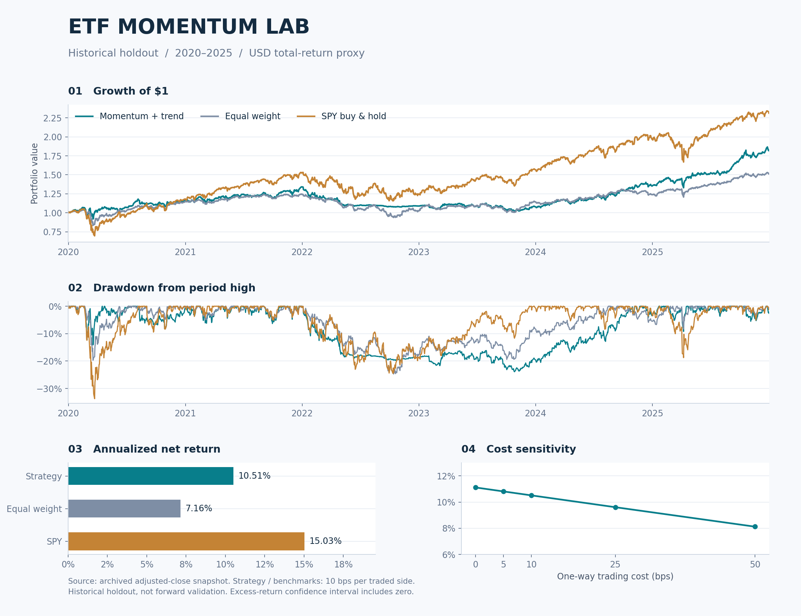

# ETF 动量与趋势因子研究报告

美国上市跨资产 ETF · 月度再平衡 · 2006—2025

[项目首页](README.md) · [研究方法](docs/METHODOLOGY.md) · [数据说明](docs/DATA.md)

## 结论

2020—2025 历史留出区间，12–1 动量加 200 日趋势过滤策略在单边 10 基点费用后年化收益 10.51%、最大回撤 23.90%。收益超过七资产等权组合，但低于 SPY 买入持有；验证期表现较弱，不能据此宣称存在稳定可交易的超额收益。

相对等权的年化算术超额收益为 3.18%，21 日区块重采样的 95% 区间为 [-4.61%, 11.16%]，跨过零。滚动预测模型在测试期 R² 为负。当前结论是“具备研究复现价值，证据不足以支持部署”。



## 研究范围

研究对象为美国上市、美元计价的跨资产 ETF。通过动量排名与趋势过滤构造月度组合，考察其相对等权配置和股票买入持有的收益、回撤及预测有效性。

风险资产池：SPY（美国大盘股）、EFA（发达市场股票）、EEM（新兴市场股票）、IEF（中期美债）、TLT（长期美债）、GLD（黄金）、VNQ（美国房地产）。防御资产 SHY 为短期美债 ETF，并非无风险现金。选择这些资产是按资产类别作研究性选择，未做全市场优化。

## 数据与清洗

数据采用 [公开镜像](https://github.com/manisahni/marketdata)，维护者声明来自 yfinance 复权收盘价缓存。该来源属于第三方镜像，尚未完成独立供应商交叉核验。

保留原始 5,688 行快照及 SHA256 `361efb287116fc8200582c15fcd315bcce2e218fa1e50b416bacc5acebff37b9`。快照包含 2026 年数据，本研究明确排除整个 2026 年，仅分析截至 2025-12-31 的完整年份；这也避免将快照最后一行缺失 ETF 价格误当行情。八只 ETF 的共同有效起点为 2004-11-18，清洗后 5313 行；2004—2005 用于预热，组合从 2006 年开始。

验证日期递增且唯一、价格正值和有限性、共同起点后无缺失，不前向或后向填充，不缩尾。超过 15% 的日收益单独列出，未机械删除危机日。检查了若干 VIX 锚点、SPY 极端日和美国劳动节缺席；这些是镜像内部合理性检查，不能替代 ETF 的第二供应商价格与分红逐笔对账。未独立验证交易所每个交易日是否全部齐备。

Yahoo 对复权价的[说明](https://help.yahoo.com/kb/SLN28256.html)包含拆分和分红调整。本研究将价格比率视作再投资总收益近似，不重复加分红。事后复权历史会被修订；比例因子在历史统一缩放下不变，但当前快照仍不是逐日封存的 point-in-time 数据。未取得原始分红、拆分和 OHLCV，因此不声称验证了盘中执行或成交容量。

## 因子与交易规则

动量为 P(t−21)/P(t−252)−1；趋势为 P(t)/过去 200 个交易日均价−1。只在月末收盘完成后计算。七只资产中同时满足动量和趋势为正者，按动量降序选前二，各占组合 50%；不足两个时剩余配置 SHY。无杠杆、无做空，持仓随价格自然漂移。

月末 t 形成目标，下一交易日 t+1 收盘执行，t+1 的收盘到收盘收益仍属于旧仓位，新仓位从 t+2 的收益开始生效。执行价是复权收盘收益代理，真实收盘集合竞价成交及冲击未被证明。仅使用完整的已结束月份生成调仓。

费用为买入和卖出成交金额分别乘以 0.1%，初次建仓也收费。调仓联立求解费用后净值与目标份额，交易额使用自然漂移后的持仓。0、5、25、50 基点作敏感性，默认 10 基点是情景假设，不是券商报价。ETF 管理费一般已体现在价格；另未计税款、跨境换汇与汇率损益、最低佣金、资金规模冲击。末日按市值估值而非强制清仓，没有末日平仓成本。

等权基准以相同日期和费用每月再平衡七只风险资产；SPY 基准初始买入后持有。指标采用每年 252 个交易日；夏普为策略收益减 SHY 日收益后的均值/标准差年化，非标准现金无风险利率夏普。CVaR 为样本最差 5% 日收益均值；回撤在每个报告区间重新从 1 计算。

## 时间划分与样本外边界

开发区间 2006—2014，验证区间 2015—2019，历史测试区间 2020—2025。策略规则在首次运行结果前固定，没有根据敏感性结果改成最优参数。参数敏感性只是事后稳健性诊断，不能用于选择后仍声称测试区间未被使用。

整个研究于 2026 年事后开展，所以“样本外”是代码时间切分和模型预测意义的历史留出，并不是事先登记、封存、从未观察过市场的真实前瞻检验。未来仍需在冻结规则后收集新的数据作前向验证。

| 区间 | 交易日数 | 年化收益 | 最大回撤 |
|---|---|---|---|
| development | 2265 | 13.66% | -19.56% |
| validation | 1258 | 4.23% | -19.67% |
| test | 1508 | 10.51% | -23.90% |
| all | 5031 | 10.29% | -23.90% |

## 留出区间收益与风险

| 组合 | 年化收益 | 年化波动 | 相对 SHY 夏普 | 最大回撤 | 日 CVaR 95% |
|---|---|---|---|---|---|
| strategy_10bps | 10.51% | 12.85% | 0.713 | -23.90% | -1.92% |
| equal_weight | 7.16% | 12.11% | 0.495 | -24.72% | -1.76% |
| SPY_buy_hold | 15.03% | 20.74% | 0.686 | -33.72% | -3.13% |

2022 年策略收益为 −18.82%，2023 年为 −0.58%，体现趋势策略在股债同跌及反转环境中的损失和滞后。防御资产有利率风险，多个股票 ETF 和两种美债也不代表独立风险来源。每只选中资产可达 50%，存在集中持仓和跳空风险。

| 设置 | 年化收益 | 最大回撤 | 年化买卖成交额/NAV |
|---|---|---|---|
| strategy_10bps | 10.51% | -23.90% | 5.461 |
| strategy_0bps | 11.12% | -23.05% | 5.464 |
| strategy_5bps | 10.81% | -23.47% | 5.463 |
| strategy_25bps | 9.61% | -25.15% | 5.458 |
| strategy_50bps | 8.12% | -27.28% | 5.452 |
| lookback_126 | 12.43% | -19.39% | 7.802 |
| lookback_189 | 9.22% | -19.86% | 7.128 |
| delay_2days | 11.34% | -19.96% | 5.462 |

默认策略测试期年化买卖成交额约净值的 5.46 倍，即单边 10 基点约形成每年 0.55% 交易成本量级。零费用年化 11.12%、50 基点费用年化 8.12%。更短回看或多延迟一天会改变表现，说明参数和执行敏感性不能忽略。

## 因子统计与预测检验

在每个信号月计算七资产横截面 Spearman 秩相关（对因子和未来收益分别取秩后算 Pearson 相关）。未来收益从下一交易日收盘到下次执行日收盘，月份之间不重叠。2025 年 12 月的下一完整持有期超过研究终点，故 IC 和预测测试仅 71 个月，而组合收益仍包含完整 2025 年。

月度 IC 使用 3 阶 Bartlett Newey–West 标准误，p 值为双侧渐近正态近似，未作多重检验校正，不以开发期的显著性作为确认性证据。横截面仅七个相关资产，统计功效有限。

| 区间 | 因子 | 月数 | 平均秩 IC | HAC t | 近似 p |
|---|---|---|---|---|---|
| validation | momentum | 60 | 0.008 | 0.106 | 0.915 |
| validation | trend | 60 | -0.073 | -1.211 | 0.226 |
| test | momentum | 71 | 0.040 | 0.720 | 0.471 |
| test | trend | 71 | 0.066 | 1.293 | 0.196 |

预测模型是带截距的两因子线性回归；从 2015 年起逐月扩展窗口重新拟合。仅使用标签结束日严格早于预测日的训练样本；标准化参数仅在训练集估计。基准预测为同期训练集全部资产收益均值。比较的是月度资产收益预测 MSE，不把拟合优度代替交易盈利。

| 区间 | 月数 | 预测样本外 R² | 损失差 HAC t | 近似 p |
|---|---|---|---|---|
| validation | 60 | 0.25% | 0.689 | 0.491 |
| test | 71 | -0.31% | -0.529 | 0.597 |

损失差先在同月资产间平均，再按月份计算 HAC，避免把七个相关资产当成七个独立月份。测试期预测 R² 约 −0.31%，没有优于简单历史均值；没有据此设计新的择时策略。

配对 bootstrap 对策略减等权的每日收益差以 21 日循环区块重采样 2,000 次，固定随机种子。区间针对年化算术平均超额收益，不是 CAGR 差，不是完整策略选择过程的置信区间；非平稳风险和先验资产选择仍未消除。

## 防未来函数验证与剩余偏差

自动测试包括：改变 2019 年之后全部价格不能影响此前信号和净值；所有预测训练标签已成熟；权重和为 1 且无负持仓；极简价格路径验证信号执行日不能赚取当日涨幅；建仓与调仓费用守恒。测试摘要见 `results/tests.txt`。

这些测试验证实现中的时序约束，不能证明外部数据没有修订，也不能消除生存者偏差。资产池是在今天选出的幸存 ETF，没有已清盘或合并基金、历史可交易池、当时流动性门槛。共同上市日期过滤避免上市前交易，但不解决幸存者选择。结论仅适用于这组资产的回顾研究，不能推广为全 ETF 市场可实现收益。

## 复现与后续研究

原始/清洗数据、配置、可运行代码、逐日持仓和净值、月度信号、预测明细、统计结果及本报告均保存在项目中。运行 `run.ps1` 可离线重建输出；报告表格由结果生成。

后续研究包括第二数据源逐日价格及分红拆分对账、包含清盘 ETF 的历史资产池、真实成交价差与容量评估，以及冻结规则后的前向观察。现有结果属于历史研究，不构成实盘有效性证明。

## 参数快照

```json
{
  "universe": [
    "SPY",
    "EFA",
    "EEM",
    "IEF",
    "TLT",
    "GLD",
    "VNQ"
  ],
  "defensive": "SHY",
  "start": "2006-01-01",
  "end": "2025-12-31",
  "lookback": 252,
  "skip": 21,
  "trend_days": 200,
  "top_k": 2,
  "cost_bps": 10,
  "seed": 20261022
}
```
